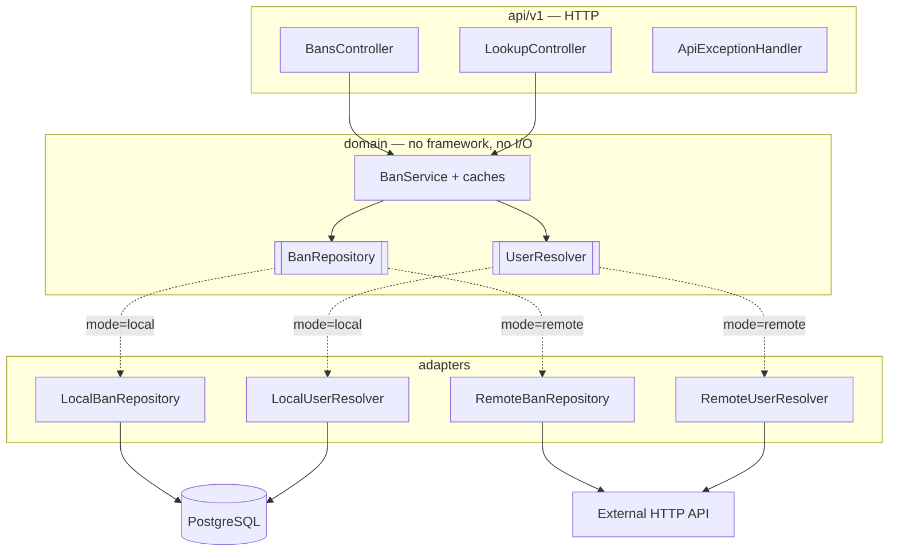

# ProxyBans — service

[](https://github.com/vanfek/proxybans-service/actions/workflows/ci.yml)
[](https://openjdk.org/projects/jdk/25/)
[](https://spring.io/projects/spring-boot)

*[Русская версия](README.ru.md)*

Reactive ban storage and lookup for Minecraft proxies. Serves the
[ProxyBans Velocity plugin](https://github.com/vanfek/proxybans-plugin) over a small HTTP API.

It runs in one of two modes, chosen by a single environment variable:

| Mode     | Source of truth                | Use case                                      |
|----------|--------------------------------|-----------------------------------------------|
| `local`  | its own PostgreSQL schema      | standalone deployment, no external backend    |
| `remote` | an existing HTTP API           | the bans already live in a website's database  |

The plugin cannot tell the difference. That is the point of the architecture rather than a
side effect of it.

---

## Try it

```bash
docker compose up --build
```

Then open <http://localhost:8080/swagger-ui.html> and send `X-Service-Token: dev-local-token`.
[`docs/api.http`](docs/api.http) is a runnable request collection covering the whole flow —
register a player, ban, inspect, unban — including the requests that are meant to be rejected.

## Architecture

Ports and adapters, with the domain in the middle and no framework types below the API layer:



Adapters are selected by `@ConditionalOnProperty`, so only one set of beans exists at runtime and a
mode switch is a restart, not a rebuild.

## Stack

Java 25 · Spring Boot 4.0 (WebFlux, Data R2DBC, Actuator, Validation) · PostgreSQL 18 ·
Liquibase · Caffeine · springdoc-openapi · Gradle 9 (Kotlin DSL) · Testcontainers

Reactive end to end: R2DBC and WebFlux, no blocking driver on the request path. The JDBC driver is
present only because Liquibase needs it at startup.

## API

Every endpoint except `/actuator/health` requires `X-Service-Token`.

```
GET    /api/v1/bans?limit=&offset=              active bans, newest first
GET    /api/v1/bans/{uuid}/active               the ban in force, or 404
GET    /api/v1/bans/{uuid}/history?limit=&offset=   punishment log
POST   /api/v1/bans                             issue a ban
DELETE /api/v1/bans/{uuid}                      lift the active ban
GET    /api/v1/lookup?name=<name>               resolve a name to a UUID
POST   /api/v1/known-players                    record a UUID/name pair (local mode)
GET    /actuator/health                         public
GET    /swagger-ui.html                         interactive API docs
```

`limit` is capped at 100 and `offset` must not be negative — enforced in the service, not trusted
from the caller.

## Configuration

| Variable                       | Purpose                                                   |
|--------------------------------|-----------------------------------------------------------|
| `PROXYBANS_MODE`               | `local` or `remote`                                       |
| `PROXYBANS_SERVICE_TOKEN`      | shared secret for `X-Service-Token`; **no default**       |
| `SPRING_PROFILES_ACTIVE`       | `local` or `remote`                                       |
| `SPRING_R2DBC_URL`             | `r2dbc:postgresql://host:5432/proxybans`                  |
| `SPRING_R2DBC_USERNAME/PASSWORD` | database credentials                                    |
| `SPRING_LIQUIBASE_URL/USER/PASSWORD` | JDBC equivalents, used for migrations only          |
| `PROXYBANS_REMOTE_BASE_URL`    | remote backend base URL (`remote` mode)                   |
| `PROXYBANS_REMOTE_API_TOKEN`   | remote backend token                                      |
| `PROXYBANS_REMOTE_TOKEN_HEADER`| header carrying that token, default `X-Server-Key`         |
| `PROXYBANS_REMOTE_PATH_*`      | endpoint layout of the remote backend                     |

The service token has no default on purpose: an unset or blank token stops startup instead of
silently accepting unauthenticated requests.

## Security notes

- The token is compared in constant time, so it cannot be recovered byte by byte.
- Only `/actuator/health` and its probes are public. `env`, `metrics` and `prometheus` describe the
  deployment and stay behind the token.
- Error responses carry a status and a short message; exception details go to the log, never into a
  body that a Minecraft plugin might echo into chat.

## Data model

Three tables in the `proxybans` schema, created by Liquibase:

- `bans` — one row per punishment. A **partial unique index** on `player_uuid WHERE active = true`
  makes "at most one active ban per player" a database guarantee rather than an application
  convention; a concurrent double-ban surfaces as a conflict and is retried, not silently accepted.
- `ban_history` — append-only punishment log, including unbans.
- `known_players` — UUID ↔ name, so the ban list can show names instead of raw UUIDs.

A scheduled sweeper deactivates expired temporary bans. Reads filter them out anyway; the sweeper
exists so the partial index does not accumulate rows that no longer mean anything.

## Tests

```bash
./gradlew test
```

- domain — caching, invalidation on issue/lift, case-insensitive name resolution, against
  hand-written in-memory ports
- HTTP — the full request path over `WebTestClient`: status codes, validation, JSON shape
- security — the token filter: missing, empty, wrong and correct tokens; which actuator paths are
  public
- integration — the local adapter against a real PostgreSQL via Testcontainers, covering the things
  a fake cannot: `@Modifying` statements, the partial unique index, the name join

Integration tests skip automatically where Docker is unavailable and always run in CI.

## Building

```bash
./gradlew bootJar        # build/libs/proxybans-service-1.0.0.jar
```

Requires JDK 25. The Gradle wrapper is committed.
