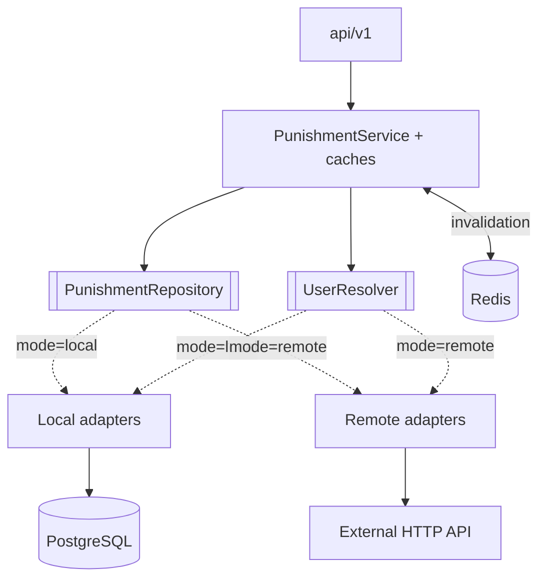

# ProxyPunishments — service

[](https://github.com/vanFEK/proxypunishments-service-example/actions/workflows/ci.yml)
[](https://openjdk.org/projects/jdk/25/)
[](https://spring.io/projects/spring-boot)

*[Русская версия](README.ru.md)*

Reactive punishment storage for Minecraft networks — bans, mutes, IP bans and warnings behind one
HTTP API. Serves the
[ProxyPunishments plugin](https://github.com/vanFEK/proxypunishments-plugin-example).

Two interchangeable sources of truth, chosen by one environment variable:

| Mode     | Source of truth               | Use case                                    |
|----------|-------------------------------|---------------------------------------------|
| `local`  | its own PostgreSQL schema     | standalone deployment                       |
| `remote` | an existing HTTP API          | the punishments already live in a website's database |

The plugin cannot tell the difference — that is the point of the architecture, not a side effect.

## Try it

```bash
docker compose up --build
```

Then <http://localhost:8080/swagger-ui.html> with `X-Service-Token: dev-local-token`.
[`docs/api.http`](docs/api.http) is a runnable collection covering the whole flow, including the
requests that are meant to be rejected.

## Architecture

Ports and adapters, with no framework types below the API layer:



Adapters are selected by `@ConditionalOnProperty`, so only one set of beans exists at runtime and
switching modes is a restart, not a rebuild.

**Stack.** Java 25 · Spring Boot 4.0 (WebFlux, Data R2DBC, Actuator) · PostgreSQL 18 · Liquibase ·
Caffeine · Redis (optional) · springdoc-openapi · Gradle 9 · Testcontainers. Reactive end to end;
the JDBC driver is present only because Liquibase needs it at startup.

## API

Every endpoint except `/actuator/health` requires `X-Service-Token`.

```
GET    /api/v1/punishments?kind=&limit=&offset=            active punishments, newest first
GET    /api/v1/punishments/{uuid}/active?kind=             the punishment in force, or 404
GET    /api/v1/punishments/{uuid}/history?limit=&offset=   punishment log
POST   /api/v1/punishments                                 issue a ban, a mute or an IP ban
DELETE /api/v1/punishments/{uuid}?kind=                    lift the active punishment
GET    /api/v1/punishments/ip/{address}/active             the IP ban in force, or 404
DELETE /api/v1/punishments/ip/{address}                    lift the IP ban on that address
GET    /api/v1/players/{uuid}/alts?limit=                  other accounts from the same address
POST   /api/v1/warnings                                    record a warning
GET    /api/v1/lookup?name=<name>                          resolve a name to a UUID
POST   /api/v1/known-players                               record a UUID/name/address (local mode)
GET    /actuator/health                                    public
GET    /swagger-ui.html                                    interactive API docs
```

`kind` is `BAN`, `MUTE` or `IP_BAN`, defaulting to `BAN`. `limit` is capped at 100 and `offset` must
not be negative — enforced in the service, not trusted from the caller.

## Configuration

| Variable                                | Purpose                                                |
|-----------------------------------------|--------------------------------------------------------|
| `PROXYPUNISHMENTS_MODE`                 | `local` or `remote`                                    |
| `PROXYPUNISHMENTS_SERVICE_TOKEN`        | shared secret for `X-Service-Token`; **no default**    |
| `SPRING_R2DBC_URL/USERNAME/PASSWORD`    | database connection                                    |
| `SPRING_LIQUIBASE_URL/USER/PASSWORD`    | JDBC equivalents, migrations only                      |
| `PROXYPUNISHMENTS_REMOTE_BASE_URL`      | remote backend base URL (`remote` mode)                |
| `PROXYPUNISHMENTS_REMOTE_API_TOKEN`     | remote backend token                                   |
| `PROXYPUNISHMENTS_REMOTE_PATH_*`        | endpoint layout; blank mute or IP paths mean the backend has none |
| `PROXYPUNISHMENTS_REDIS_ENABLED`        | cross-node cache invalidation; default `false`         |
| `PROXYPUNISHMENTS_REDIS_HOST/PORT`      | where Redis listens                                    |
| `PROXYPUNISHMENTS_DISCORD_ENABLED`      | webhook announcements; default `false`                 |
| `PROXYPUNISHMENTS_DISCORD_WEBHOOK_URL`  | Discord webhook URL                                    |

The service token has no default on purpose: an unset or blank token stops startup instead of
silently accepting unauthenticated requests.

With Redis on, issuing or lifting a punishment publishes an invalidation that every service replica
and every proxy consumes immediately, instead of each waiting out its own TTL. With Redis off or
unreachable, everything falls back to TTL staleness and nothing fails.

## Security

- The token is compared in constant time.
- Only `/actuator/health` and its probes are public; `env`, `metrics` and `prometheus` stay behind
  the token because they describe the deployment.
- Error responses carry a status and a short message; details go to the log, never into a body a
  plugin might echo into chat.

## Data model

Three tables in the `proxypunishments` schema, created by Liquibase:

- `punishments` — one row per punishment. A **partial unique index** makes "at most one active
  punishment per player per kind" a database guarantee rather than an application convention, with a
  second one covering active IP bans by address; a concurrent double-ban surfaces as a conflict and
  is retried, not silently accepted.
- `ban_history` — append-only log, including lifts and warnings.
- `known_players` — UUID, name and last address, which is what makes alt detection an index lookup.

A scheduled sweeper retires expired punishments so the partial index does not accumulate rows that
no longer mean anything.

## Personal data

The service stores player addresses because IP bans and alt detection cannot work without them. It
never expires them on its own — retention is the operator's call, and a deployment subject to GDPR
or similar needs a policy on top of this service.

## Metrics

`/actuator/prometheus`, behind the token: `proxypunishments.punishments.issued|lifted{kind}`,
`proxypunishments.cache.lookups{cache,result}`, `proxypunishments.repository.calls{operation}`,
`proxypunishments.invalidations.published|received`, `proxypunishments.webhook.deliveries{outcome}`.

## Load profile

[`docs/load/`](docs/load/) holds a k6 profile weighted the way a live network actually behaves —
mostly login checks, a trickle of moderator actions. The results table there is deliberately empty:
benchmark numbers are only worth anything from a real run on known hardware.

## Building

```bash
./gradlew bootJar        # build/libs/proxypunishments-service-1.0.0.jar
```

Requires JDK 25. `build` also runs Checkstyle (`config/checkstyle/checkstyle.xml`); a `v*` tag
triggers a release. See [CHANGELOG.md](CHANGELOG.md).

## Tests

110 tests:

- domain — caching per kind, invalidation on write, case-insensitive name resolution, against
  hand-written in-memory ports
- HTTP — the full request path over `WebTestClient`: status codes, validation, JSON shape
- security — the token filter, and which actuator paths are public
- integration — the local adapter against a real PostgreSQL via Testcontainers: `@Modifying`
  statements, both partial unique indexes, the name join and the alt query

Integration tests skip where Docker is unavailable and always run in CI.
