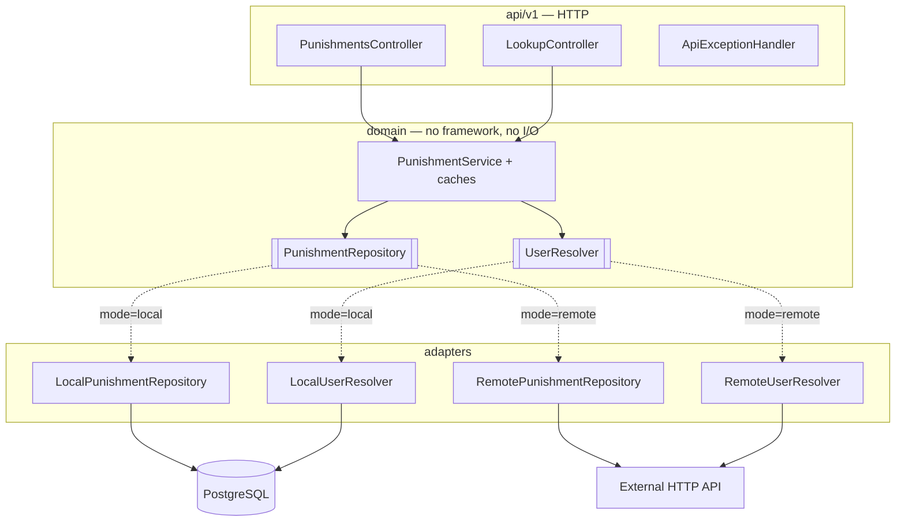
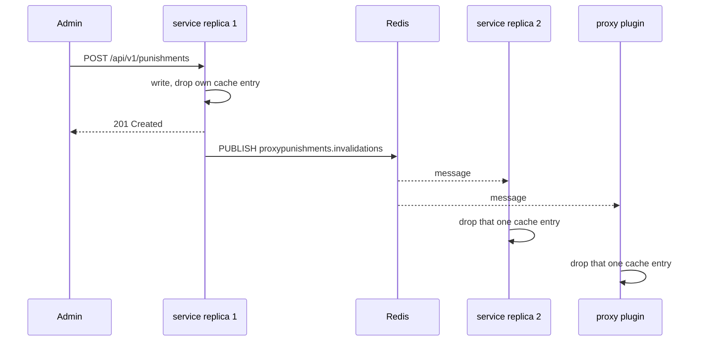

# ProxyPunishments — service

[](https://github.com/vanfek/proxypunishments-service/actions/workflows/ci.yml)
[](https://openjdk.org/projects/jdk/25/)
[](https://spring.io/projects/spring-boot)

*[Русская версия](README.ru.md)*

Reactive punishment storage and lookup for Minecraft proxies — bans, mutes and warnings. Serves the
[ProxyPunishments Velocity plugin](https://github.com/vanfek/proxypunishments-plugin) over a small HTTP API.

It runs in one of two modes, chosen by a single environment variable:

| Mode     | Source of truth                | Use case                                      |
|----------|--------------------------------|-----------------------------------------------|
| `local`  | its own PostgreSQL schema      | standalone deployment, no external backend    |
| `remote` | an existing HTTP API           | the punishments already live in a website's database |

The plugin cannot tell the difference. That is the point of the architecture rather than a
side effect of it.

---

## Try it

```bash
docker compose up --build
```

Then open <http://localhost:8080/swagger-ui.html> and send `X-Service-Token: dev-local-token`.
[`docs/api.http`](docs/api.http) is a runnable request collection covering the whole flow —
register a player, ban, mute, warn, inspect, lift — including the requests that are meant to be
rejected.

The compose stack brings a Redis alongside Postgres and turns cross-node cache invalidation on, so
the whole thing is visible end to end: `docker compose exec redis redis-cli subscribe
proxypunishments.invalidations` prints a message for every punishment issued or lifted. Take the
Redis out and everything still works — see [below](#cross-node-cache-invalidation).

## Architecture

Ports and adapters, with the domain in the middle and no framework types below the API layer:



Adapters are selected by `@ConditionalOnProperty`, so only one set of beans exists at runtime and a
mode switch is a restart, not a rebuild.

## Cross-node cache invalidation

The service caches active punishments for `cache.active-punishment-ttl` (30 s). Without help, a ban
issued through one service replica stays invisible to another replica's cache — and to every proxy's
cache — until that TTL runs out. That is the honest weakness of a cache-per-node design.

Redis pub/sub closes it. On every issue and lift the service publishes one small message to a
channel:

```json
{ "target": "<player uuid or ip address>", "kind": "BAN", "origin": "<node id>" }
```

Everyone subscribed drops exactly that one entry:



`origin` is the publishing node's id, so a replica ignores what it published itself. A message whose
target is neither a UUID nor a literal address, or whose kind is unknown, is dropped rather than
allowed to clear anything.

**Entirely optional and off by default.** `proxypunishments.redis.enabled=false` means no Redis
beans exist at all — there is nothing to fail. Turned on, an unreachable Redis is still harmless:
the connection is opened lazily, so startup succeeds, a failed publish is logged once and swallowed,
and the subscription retries with backoff in the background. Every answer stays correct; it just
goes back to expiring after the TTL.

## Discord announcements

Optional and off by default. With `proxypunishments.discord.enabled=true` and a webhook URL, each
issued and lifted punishment is posted as an embed. Which of the two is announced is configurable.

Failures never reach the moderator: a transport error or an error status is logged once and dropped,
and a `429` silences the webhook for the window Discord asks for in `Retry-After` (5 s if it does not
say, 15 min at most) rather than retrying into the rate limit. Nothing is queued and nothing is
retried — a moderation action must not wait on a chat server.

## Metrics

`/actuator/prometheus` sits behind the service token like every other endpoint. Everything this
service adds is named under one prefix:

| Metric | Type | Tags | What it says |
|--------|------|------|--------------|
| `proxypunishments.punishments.issued` | counter | `kind` | punishments issued, per `BAN`/`MUTE`/`IP_BAN` |
| `proxypunishments.punishments.lifted` | counter | `kind` | punishments lifted, per kind |
| `proxypunishments.cache.lookups` | counter | `cache`, `result` | cache hit ratio: `cache` is `active-punishment`, `ip-ban` or `lookup`, `result` is `hit` or `miss` |
| `proxypunishments.repository.calls` | timer | `operation` | how long the store takes per operation (`findActive`, `issue`, `lift`, `history`, …) |
| `proxypunishments.invalidations.published` | counter | — | invalidation messages this node put on the channel |
| `proxypunishments.invalidations.received` | counter | — | invalidation messages this node applied to its cache |
| `proxypunishments.webhook.deliveries` | counter | `outcome` | Discord deliveries: `sent`, `failed`, `rate-limited`, `suppressed` |

The active-punishment cache hit ratio is
`proxypunishments_cache_lookups_total{cache="active-punishment",result="hit"}` over the sum of both
results. A `published` counter that stays flat while punishments are being issued means Redis is not
taking the writes; a `received` counter that stays flat on a busy network means this node is not
hearing them.

## Stack

Java 25 · Spring Boot 4.0 (WebFlux, Data R2DBC, Actuator, Validation) · PostgreSQL 18 ·
Redis (optional) · Liquibase · Caffeine · Micrometer · springdoc-openapi · Gradle 9 (Kotlin DSL) ·
Testcontainers

Reactive end to end: R2DBC and WebFlux, no blocking driver on the request path. The JDBC driver is
present only because Liquibase needs it at startup.

## API

Every endpoint except `/actuator/health` requires `X-Service-Token`.

```
GET    /api/v1/punishments?kind=&limit=&offset=            active punishments, newest first
GET    /api/v1/punishments/{uuid}/active?kind=             the punishment in force, or 404
GET    /api/v1/punishments/{uuid}/history?limit=&offset=   punishment log
POST   /api/v1/punishments                                 issue a ban, a mute or an IP ban
DELETE /api/v1/punishments/{uuid}?kind=                    lift the active punishment
GET    /api/v1/punishments/ip/{address}/active             the IP ban in force, or 404
DELETE /api/v1/punishments/ip/{address}                    lift the IP ban on that address
GET    /api/v1/players/{uuid}/alts?limit=                  other accounts from the same address
POST   /api/v1/warnings                                    record a warning
GET    /api/v1/lookup?name=<name>                          resolve a name to a UUID
POST   /api/v1/known-players                               record a UUID/name/address (local mode)
GET    /actuator/health                                    public
GET    /swagger-ui.html                                    interactive API docs
```

`kind` is `BAN`, `MUTE` or `IP_BAN` and defaults to `BAN` wherever it is accepted. A player can
carry one active ban and one active mute at the same time; the two never shadow each other. An IP
ban targets an address rather than a player, so it is issued with `ipAddress` and read back through
the `/punishments/ip/...` endpoints; `playerUuid` records whose connection triggered it, or the nil
UUID when the address was banned on its own. A warning is log-only — it has no duration, no active
state and nothing to lift.

An address is only accepted as a literal IPv4 or IPv6 address; anything else is a `400`, never a
stored value. An **alt** is another UUID last seen from the same address as the player asked about:
the answer carries each alt's login and when it was last seen, most recent first, and never includes
the player themselves.

`limit` is capped at 100 and `offset` must not be negative — enforced in the service, not trusted
from the caller.

## Configuration

| Variable                       | Purpose                                                   |
|--------------------------------|-----------------------------------------------------------|
| `PROXYPUNISHMENTS_MODE`               | `local` or `remote`                                       |
| `PROXYPUNISHMENTS_SERVICE_TOKEN`      | shared secret for `X-Service-Token`; **no default**       |
| `SPRING_PROFILES_ACTIVE`       | `local` or `remote`                                       |
| `SPRING_R2DBC_URL`             | `r2dbc:postgresql://host:5432/proxypunishments`                  |
| `SPRING_R2DBC_USERNAME/PASSWORD` | database credentials                                    |
| `SPRING_LIQUIBASE_URL/USER/PASSWORD` | JDBC equivalents, used for migrations only          |
| `PROXYPUNISHMENTS_REMOTE_BASE_URL`    | remote backend base URL (`remote` mode)                   |
| `PROXYPUNISHMENTS_REMOTE_API_TOKEN`   | remote backend token                                      |
| `PROXYPUNISHMENTS_REMOTE_TOKEN_HEADER`| header carrying that token, default `X-Server-Key`         |
| `PROXYPUNISHMENTS_REMOTE_PATH_*`      | endpoint layout of the remote backend                     |
| `PROXYPUNISHMENTS_REMOTE_PATH_*_MUTE` | mute endpoints; blank means the backend has none          |
| `PROXYPUNISHMENTS_REMOTE_PATH_*_IP_BAN` | IP-ban endpoints; blank means the backend has none      |
| `PROXYPUNISHMENTS_REDIS_ENABLED`      | `true` turns on cross-node cache invalidation; default `false` |
| `PROXYPUNISHMENTS_REDIS_HOST/PORT`    | where Redis listens, default `localhost:6379`              |
| `PROXYPUNISHMENTS_REDIS_USERNAME/PASSWORD` | Redis credentials; blank means none                  |
| `PROXYPUNISHMENTS_REDIS_DATABASE`     | Redis database index, default `0`                         |
| `PROXYPUNISHMENTS_REDIS_CHANNEL`      | invalidation channel, default `proxypunishments.invalidations` |
| `PROXYPUNISHMENTS_DISCORD_ENABLED`    | `true` turns on webhook announcements; default `false`    |
| `PROXYPUNISHMENTS_DISCORD_WEBHOOK_URL`| Discord webhook URL                                       |
| `PROXYPUNISHMENTS_DISCORD_ANNOUNCE_ISSUED` | announce issued punishments, default `true`          |
| `PROXYPUNISHMENTS_DISCORD_ANNOUNCE_LIFTED` | announce lifted punishments, default `true`          |

The service token has no default on purpose: an unset or blank token stops startup instead of
silently accepting unauthenticated requests. The mute and IP-ban paths are blank by default instead:
a backend that only knows about bans leaves them unset, and those reads and writes degrade to empty
results rather than failing. Redis and Discord are off by default and stay entirely absent until
their `ENABLED` flag is set — neither can affect a deployment that does not ask for it.

## Security notes

- The token is compared in constant time, so it cannot be recovered byte by byte.
- Only `/actuator/health` and its probes are public. `env`, `metrics` and `prometheus` describe the
  deployment and stay behind the token.
- Error responses carry a status and a short message; exception details go to the log, never into a
  body that a Minecraft plugin might echo into chat.

## Personal data

Enabling alt detection means the service stores IP addresses: `known_players.last_ip` holds the
address a player was last seen from, `known_players.first_seen_at` when they were first seen, and
`punishments.ip_address` the address an IP ban covers. That is the minimum needed to enforce an IP
ban at login and to answer "which other accounts came from this address". An IP address is personal
data in most jurisdictions; how long it is kept, who may read it and when it is erased are the
operator's responsibility, not the service's — nothing here expires the addresses on its own. The
plugin sends no address at all when `login.remember-player` is off.

## Data model

Three tables in the `proxypunishments` schema, created by Liquibase:

- `punishments` — one row per ban, mute or IP ban, told apart by `kind`. A **partial unique index**
  on `(player_uuid, kind) WHERE active = true` makes "at most one active punishment per player per
  kind" a database guarantee rather than an application convention; a concurrent double-punishment
  surfaces as a conflict and is retried, not silently accepted. Because `kind` is part of the key,
  a mute never collides with that player's ban. IP bans are keyed by address instead: a second
  partial unique index on `(ip_address) WHERE active = true AND kind = 'IP_BAN'` allows at most one
  active ban per address, whoever it was raised through.
- `ban_history` — append-only punishment log: `BAN`, `PERMBAN`, `UNBAN`, `MUTE`, `PERMMUTE`,
  `UNMUTE`, `IPBAN`, `PERMIPBAN`, `UNIPBAN` and `WARN`. Warnings live here and nowhere else.
- `known_players` — UUID ↔ name, so the punishment list can show names instead of raw UUIDs, plus
  `last_ip` and `first_seen_at`. The alt query matches `last_ip` against the target's own, and an
  index on `known_players(last_ip)` keeps it off a sequential scan.

A scheduled sweeper deactivates expired temporary punishments of every kind. Reads filter them out
anyway; the sweeper exists so the partial index does not accumulate rows that no longer mean
anything.

## Tests

```bash
./gradlew test
```

- domain — caching keyed by player *and* kind and, separately, by address, invalidation on
  issue/lift, bans, mutes and IP bans side by side, alts ordered by recency and excluding the player,
  warnings that stay out of the active state, case-insensitive name resolution, against hand-written
  in-memory ports
- HTTP — the full request path over `WebTestClient`: status codes, validation including addresses
  that are not addresses, JSON shape
- security — the token filter: missing, empty, wrong and correct tokens; which actuator paths are
  public
- invalidation — an event dropping the right cache entry and only that one, addresses and players
  kept apart, a node ignoring what it published itself, malformed payloads dropped rather than
  applied, a failing publish never reaching the caller, and the wiring itself: Redis off means no
  Redis beans, Redis on but unreachable still starts. All of it against an in-memory channel, no
  Redis anywhere
- notifications — the webhook swallowing a transport failure and an error status, a `429` silencing
  it instead of retrying, and the announced events honouring the configuration
- metrics — issued and lifted counters per kind, cache hits against misses, repository timers under
  their operation, invalidations published and received
- integration — the local adapter against a real PostgreSQL via Testcontainers, covering the things
  a fake cannot: `@Modifying` statements, the partial unique indexes on `(player_uuid, kind)` and on
  `(ip_address)`, the alt query, the name join; and one invalidation round trip through a real Redis

Integration tests skip automatically where Docker is unavailable and always run in CI.

## Load profile

[`docs/load/`](docs/load/) holds a k6 profile pointed at the one endpoint on a critical path — the
active-punishment lookup every login waits on — with moderator writes running alongside at a
realistic trickle, because a write path measured on its own says nothing about how it behaves next
to the read load that actually exists. It ramps to 800 lookups/s against a UUID pool larger than the
cache, so a meaningful share of the reads reach PostgreSQL instead of measuring Caffeine.

```bash
k6 run -e TOKEN=dev-local-token -e HOST=http://localhost:8080 docs/load/punishments.js
```

The results table in [`docs/load/README.md`](docs/load/README.md) is intentionally empty. Numbers
are worth nothing unless they come from a real run on known hardware, and a benchmark table invented
by whoever wrote the script is worse than no table at all.

## Building

```bash
./gradlew bootJar        # build/libs/proxypunishments-service-1.0.0.jar
./gradlew build          # the same jar, plus Checkstyle and the tests
```

Requires JDK 25. The Gradle wrapper is committed.

Checkstyle is part of `build` and fails it on a style regression. The rules live in
[`config/checkstyle/checkstyle.xml`](config/checkstyle/checkstyle.xml) and describe the conventions
the sources already follow — a style check that demands a reformat is a style check nobody runs.

Notable changes are recorded in [`CHANGELOG.md`](CHANGELOG.md). Pushing a `v*` tag runs the release
workflow, which builds the service and attaches the jar to the GitHub release.
