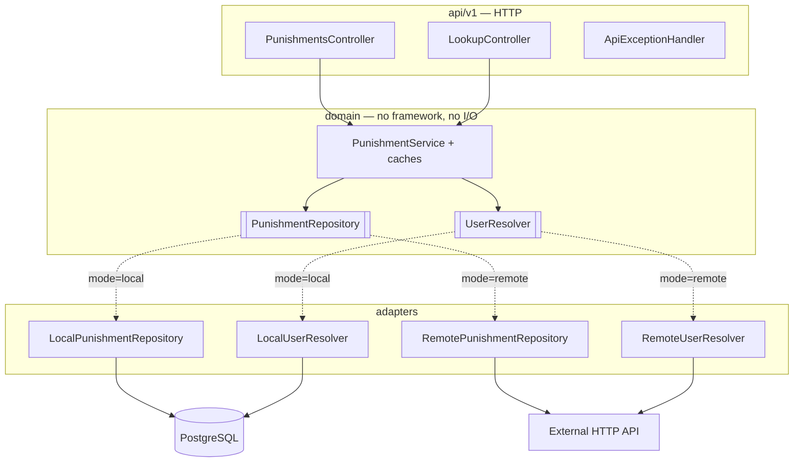

# ProxyPunishments — service

[](https://github.com/vanfek/proxypunishments-service/actions/workflows/ci.yml)
[](https://openjdk.org/projects/jdk/25/)
[](https://spring.io/projects/spring-boot)

*[Русская версия](README.ru.md)*

Reactive punishment storage and lookup for Minecraft proxies — bans, mutes and warnings. Serves the
[ProxyPunishments Velocity plugin](https://github.com/vanfek/proxypunishments-plugin) over a small HTTP API.

It runs in one of two modes, chosen by a single environment variable:

| Mode     | Source of truth                | Use case                                      |
|----------|--------------------------------|-----------------------------------------------|
| `local`  | its own PostgreSQL schema      | standalone deployment, no external backend    |
| `remote` | an existing HTTP API           | the punishments already live in a website's database |

The plugin cannot tell the difference. That is the point of the architecture rather than a
side effect of it.

---

## Try it

```bash
docker compose up --build
```

Then open <http://localhost:8080/swagger-ui.html> and send `X-Service-Token: dev-local-token`.
[`docs/api.http`](docs/api.http) is a runnable request collection covering the whole flow —
register a player, ban, mute, warn, inspect, lift — including the requests that are meant to be
rejected.

## Architecture

Ports and adapters, with the domain in the middle and no framework types below the API layer:



Adapters are selected by `@ConditionalOnProperty`, so only one set of beans exists at runtime and a
mode switch is a restart, not a rebuild.

## Stack

Java 25 · Spring Boot 4.0 (WebFlux, Data R2DBC, Actuator, Validation) · PostgreSQL 18 ·
Liquibase · Caffeine · springdoc-openapi · Gradle 9 (Kotlin DSL) · Testcontainers

Reactive end to end: R2DBC and WebFlux, no blocking driver on the request path. The JDBC driver is
present only because Liquibase needs it at startup.

## API

Every endpoint except `/actuator/health` requires `X-Service-Token`.

```
GET    /api/v1/punishments?kind=&limit=&offset=            active punishments, newest first
GET    /api/v1/punishments/{uuid}/active?kind=             the punishment in force, or 404
GET    /api/v1/punishments/{uuid}/history?limit=&offset=   punishment log
POST   /api/v1/punishments                                 issue a ban or a mute
DELETE /api/v1/punishments/{uuid}?kind=                    lift the active punishment
POST   /api/v1/warnings                                    record a warning
GET    /api/v1/lookup?name=<name>                          resolve a name to a UUID
POST   /api/v1/known-players                               record a UUID/name pair (local mode)
GET    /actuator/health                                    public
GET    /swagger-ui.html                                    interactive API docs
```

`kind` is `BAN` or `MUTE` and defaults to `BAN` wherever it is accepted. A player can carry one
active ban and one active mute at the same time; the two never shadow each other. A warning is
log-only — it has no duration, no active state and nothing to lift.

`limit` is capped at 100 and `offset` must not be negative — enforced in the service, not trusted
from the caller.

## Configuration

| Variable                       | Purpose                                                   |
|--------------------------------|-----------------------------------------------------------|
| `PROXYPUNISHMENTS_MODE`               | `local` or `remote`                                       |
| `PROXYPUNISHMENTS_SERVICE_TOKEN`      | shared secret for `X-Service-Token`; **no default**       |
| `SPRING_PROFILES_ACTIVE`       | `local` or `remote`                                       |
| `SPRING_R2DBC_URL`             | `r2dbc:postgresql://host:5432/proxypunishments`                  |
| `SPRING_R2DBC_USERNAME/PASSWORD` | database credentials                                    |
| `SPRING_LIQUIBASE_URL/USER/PASSWORD` | JDBC equivalents, used for migrations only          |
| `PROXYPUNISHMENTS_REMOTE_BASE_URL`    | remote backend base URL (`remote` mode)                   |
| `PROXYPUNISHMENTS_REMOTE_API_TOKEN`   | remote backend token                                      |
| `PROXYPUNISHMENTS_REMOTE_TOKEN_HEADER`| header carrying that token, default `X-Server-Key`         |
| `PROXYPUNISHMENTS_REMOTE_PATH_*`      | endpoint layout of the remote backend                     |
| `PROXYPUNISHMENTS_REMOTE_PATH_*_MUTE` | mute endpoints; blank means the backend has none          |

The service token has no default on purpose: an unset or blank token stops startup instead of
silently accepting unauthenticated requests. The mute paths are blank by default instead: a backend
that only knows about bans leaves them unset, and mute reads and writes degrade to empty results
rather than failing.

## Security notes

- The token is compared in constant time, so it cannot be recovered byte by byte.
- Only `/actuator/health` and its probes are public. `env`, `metrics` and `prometheus` describe the
  deployment and stay behind the token.
- Error responses carry a status and a short message; exception details go to the log, never into a
  body that a Minecraft plugin might echo into chat.

## Data model

Three tables in the `proxypunishments` schema, created by Liquibase:

- `punishments` — one row per ban or mute, told apart by `kind`. A **partial unique index** on
  `(player_uuid, kind) WHERE active = true` makes "at most one active punishment per player per
  kind" a database guarantee rather than an application convention; a concurrent double-punishment
  surfaces as a conflict and is retried, not silently accepted. Because `kind` is part of the key,
  a mute never collides with that player's ban.
- `ban_history` — append-only punishment log: `BAN`, `PERMBAN`, `UNBAN`, `MUTE`, `PERMMUTE`,
  `UNMUTE` and `WARN`. Warnings live here and nowhere else.
- `known_players` — UUID ↔ name, so the punishment list can show names instead of raw UUIDs.

A scheduled sweeper deactivates expired temporary punishments of both kinds. Reads filter them out
anyway; the sweeper exists so the partial index does not accumulate rows that no longer mean
anything.

## Tests

```bash
./gradlew test
```

- domain — caching keyed by player *and* kind, invalidation on issue/lift, bans and mutes side by
  side, warnings that stay out of the active state, case-insensitive name resolution, against
  hand-written in-memory ports
- HTTP — the full request path over `WebTestClient`: status codes, validation, JSON shape
- security — the token filter: missing, empty, wrong and correct tokens; which actuator paths are
  public
- integration — the local adapter against a real PostgreSQL via Testcontainers, covering the things
  a fake cannot: `@Modifying` statements, the partial unique index on `(player_uuid, kind)`, the
  name join

Integration tests skip automatically where Docker is unavailable and always run in CI.

## Building

```bash
./gradlew bootJar        # build/libs/proxypunishments-service-1.0.0.jar
```

Requires JDK 25. The Gradle wrapper is committed.
