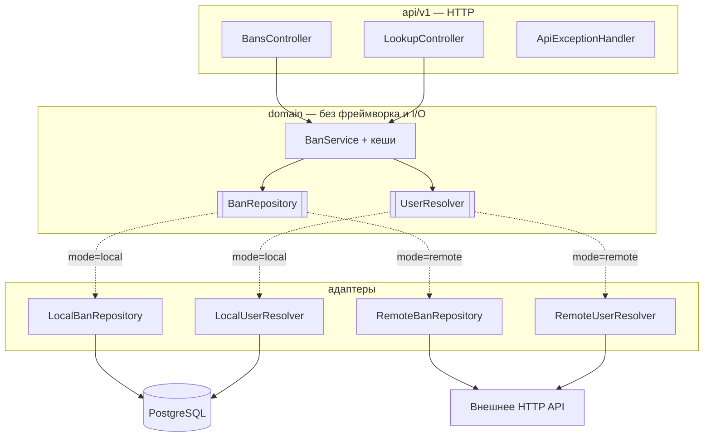

# ProxyBans — сервис

[](https://github.com/vanfek/proxybans-service/actions/workflows/ci.yml)
[](https://openjdk.org/projects/jdk/25/)
[](https://spring.io/projects/spring-boot)

*[English version](README.md)*

Реактивное хранилище банов для Minecraft-прокси. Обслуживает
[плагин ProxyBans для Velocity](https://github.com/vanfek/proxybans-plugin) по небольшому HTTP API.

Работает в одном из двух режимов, переключается одной переменной окружения:

| Режим    | Источник истины               | Когда нужен                                  |
|----------|-------------------------------|----------------------------------------------|
| `local`  | собственная схема в PostgreSQL | автономный деплой без внешнего бэкенда       |
| `remote` | существующее HTTP API          | баны уже лежат в базе сайта                  |

Плагин разницы не видит. Это и есть смысл архитектуры, а не побочный эффект.

---

## Попробовать

```bash
docker compose up --build
```

Дальше <http://localhost:8080/swagger-ui.html> и заголовок `X-Service-Token: dev-local-token`.
[`docs/api.http`](docs/api.http) — готовый набор запросов на весь сценарий: зарегистрировать игрока,
забанить, посмотреть, разбанить, включая запросы, которые должны быть отклонены.

## Архитектура

Порты и адаптеры: домен в центре, ниже слоя API нет ни одного фреймворкового типа.



Адаптеры выбираются через `@ConditionalOnProperty`, так что в рантайме существует только один
набор бинов, а смена режима — это рестарт, а не пересборка.

## Стек

Java 25 · Spring Boot 4.0 (WebFlux, Data R2DBC, Actuator, Validation) · PostgreSQL 18 ·
Liquibase · Caffeine · springdoc-openapi · Gradle 9 (Kotlin DSL) · Testcontainers

Реактивно насквозь: R2DBC и WebFlux, блокирующего драйвера на пути запроса нет. JDBC-драйвер лежит
рядом только потому, что он нужен Liquibase на старте.

## API

Все эндпоинты, кроме `/actuator/health`, требуют `X-Service-Token`.

```
GET    /api/v1/bans?limit=&offset=              активные баны, свежие сверху
GET    /api/v1/bans/{uuid}/active               действующий бан или 404
GET    /api/v1/bans/{uuid}/history?limit=&offset=   журнал наказаний
POST   /api/v1/bans                             выдать бан
DELETE /api/v1/bans/{uuid}                      снять активный бан
GET    /api/v1/lookup?name=<ник>                резолв ника в UUID
POST   /api/v1/known-players                    записать пару UUID/ник (режим local)
GET    /actuator/health                         без авторизации
GET    /swagger-ui.html                         интерактивная документация
```

`limit` ограничен сотней, `offset` не может быть отрицательным — проверяется в сервисе, а не
принимается на веру от вызывающего.

## Конфигурация

| Переменная                      | Назначение                                              |
|---------------------------------|---------------------------------------------------------|
| `PROXYBANS_MODE`                | `local` или `remote`                                    |
| `PROXYBANS_SERVICE_TOKEN`       | общий секрет для `X-Service-Token`; **без дефолта**     |
| `SPRING_PROFILES_ACTIVE`        | `local` или `remote`                                    |
| `SPRING_R2DBC_URL`              | `r2dbc:postgresql://host:5432/proxybans`                |
| `SPRING_R2DBC_USERNAME/PASSWORD`| доступ к БД                                             |
| `SPRING_LIQUIBASE_URL/USER/PASSWORD` | то же по JDBC, только для миграций                 |
| `PROXYBANS_REMOTE_BASE_URL`     | базовый URL внешнего бэкенда (режим `remote`)           |
| `PROXYBANS_REMOTE_API_TOKEN`    | токен внешнего бэкенда                                  |
| `PROXYBANS_REMOTE_TOKEN_HEADER` | заголовок для него, по умолчанию `X-Server-Key`         |
| `PROXYBANS_REMOTE_PATH_*`       | раскладка эндпоинтов внешнего бэкенда                   |

У токена нет значения по умолчанию намеренно: пустой или незаданный токен останавливает запуск,
а не превращается в тихий приём неаутентифицированных запросов.

## Про безопасность

- Токен сравнивается за константное время — его нельзя подобрать побайтово.
- Публичны только `/actuator/health` и его пробы. `env`, `metrics` и `prometheus` описывают
  внутренности деплоя и остаются за токеном.
- В ответах об ошибке — статус и короткое сообщение; детали исключения уходят в лог, а не в тело,
  которое плагин может вывести в чат.

## Модель данных

Три таблицы в схеме `proxybans`, создаются Liquibase:

- `bans` — строка на наказание. **Частичный уникальный индекс** по `player_uuid WHERE active = true`
  делает «не больше одного активного бана на игрока» гарантией БД, а не соглашением в коде;
  параллельный двойной бан всплывает как конфликт и повторяется, а не проходит незаметно.
- `ban_history` — журнал наказаний только на добавление, включая разбаны.
- `known_players` — UUID ↔ ник, чтобы список банов показывал ники, а не голые UUID.

Фоновая задача деактивирует истёкшие временные баны. Чтение их и так отфильтровывает; задача нужна,
чтобы частичный индекс не копил строки, которые уже ничего не значат.

## Тесты

```bash
./gradlew test
```

- домен — кеширование, инвалидация при выдаче и снятии, регистронезависимый резолв ников, на
  рукописных in-memory портах
- HTTP — весь путь запроса через `WebTestClient`: коды, валидация, форма JSON
- безопасность — фильтр токена: отсутствующий, пустой, неверный и верный; какие пути actuator публичны
- интеграция — локальный адаптер против настоящего PostgreSQL через Testcontainers: то, чего фейк
  дать не может — `@Modifying`, частичный уникальный индекс, join с ником

Интеграционные тесты сами пропускаются там, где нет Docker, и всегда идут в CI.

## Сборка

```bash
./gradlew bootJar        # build/libs/proxybans-service-1.0.0.jar
```

Нужен JDK 25. Gradle wrapper закоммичен.
