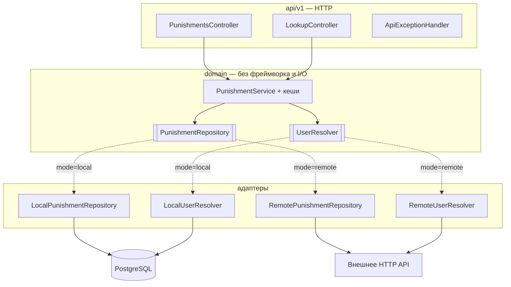
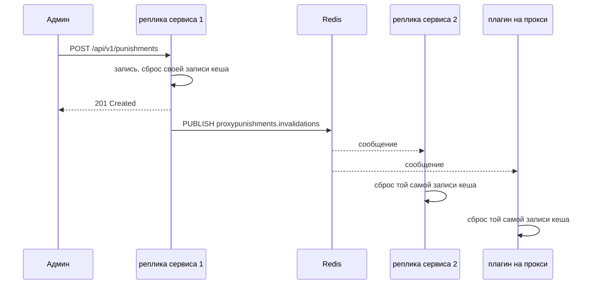

# ProxyPunishments — сервис

[](https://github.com/vanfek/proxypunishments-service/actions/workflows/ci.yml)
[](https://openjdk.org/projects/jdk/25/)
[](https://spring.io/projects/spring-boot)

*[English version](README.md)*

Реактивное хранилище наказаний для Minecraft-прокси — баны, муты и предупреждения. Обслуживает
[плагин ProxyPunishments для Velocity](https://github.com/vanfek/proxypunishments-plugin) по небольшому HTTP API.

Работает в одном из двух режимов, переключается одной переменной окружения:

| Режим    | Источник истины               | Когда нужен                                  |
|----------|-------------------------------|----------------------------------------------|
| `local`  | собственная схема в PostgreSQL | автономный деплой без внешнего бэкенда       |
| `remote` | существующее HTTP API          | наказания уже лежат в базе сайта             |

Плагин разницы не видит. Это и есть смысл архитектуры, а не побочный эффект.

---

## Попробовать

```bash
docker compose up --build
```

Дальше <http://localhost:8080/swagger-ui.html> и заголовок `X-Service-Token: dev-local-token`.
[`docs/api.http`](docs/api.http) — готовый набор запросов на весь сценарий: зарегистрировать игрока,
забанить, замутить, выдать предупреждение, посмотреть, снять, включая запросы, которые должны быть
отклонены.

В compose рядом с Postgres поднимается Redis и включается межузловая инвалидация кеша, так что всё
видно целиком: `docker compose exec redis redis-cli subscribe proxypunishments.invalidations` печатает
сообщение на каждую выдачу и снятие. Уберите Redis — всё продолжит работать, см.
[ниже](#межузловая-инвалидация-кеша).

## Архитектура

Порты и адаптеры: домен в центре, ниже слоя API нет ни одного фреймворкового типа.



Адаптеры выбираются через `@ConditionalOnProperty`, так что в рантайме существует только один
набор бинов, а смена режима — это рестарт, а не пересборка.

## Межузловая инвалидация кеша

Сервис держит активные наказания в кеше `cache.active-punishment-ttl` (30 с). Без посторонней помощи
бан, выданный через одну реплику, невидим кешу другой реплики — и кешу каждого прокси — пока не
истечёт этот TTL. Это честная слабость схемы «кеш на каждом узле».

Её закрывает Redis pub/sub. На каждую выдачу и снятие сервис публикует в канал одно короткое
сообщение:

```json
{ "target": "<uuid игрока или ip-адрес>", "kind": "BAN", "origin": "<id узла>" }
```

Все подписчики выбрасывают ровно одну запись:



`origin` — идентификатор узла-отправителя, поэтому реплика игнорирует то, что опубликовала сама.
Сообщение, у которого target не UUID и не литеральный адрес, либо неизвестный kind, отбрасывается,
а не чистит кеш.

**Полностью необязательно и выключено по умолчанию.** При `proxypunishments.redis.enabled=false`
бинов Redis не существует вовсе — ломаться нечему. Включённый, но недоступный Redis тоже безвреден:
соединение открывается лениво, поэтому старт проходит, неудачная публикация логируется один раз и
проглатывается, а подписка переподключается в фоне с backoff. Ответы остаются верными — просто снова
живут до истечения TTL.

## Уведомления в Discord

Необязательно и выключено по умолчанию. При `proxypunishments.discord.enabled=true` и заданном
webhook каждое выданное и снятое наказание уходит embed'ом. Какие из двух событий объявлять —
настраивается.

Сбои до модератора не доходят: ошибка транспорта или ошибочный статус логируются один раз и
отбрасываются, а `429` затыкает webhook на срок из `Retry-After` (5 с, если его нет, максимум
15 минут) вместо повторов в лимит. Ничего не копится в очередь и ничего не переотправляется —
модерация не должна ждать чат-сервер.

## Метрики

`/actuator/prometheus` закрыт сервисным токеном, как и всё остальное. Всё, что добавляет сервис,
лежит под одним префиксом:

| Метрика | Тип | Теги | Что показывает |
|---------|-----|------|----------------|
| `proxypunishments.punishments.issued` | counter | `kind` | выдано наказаний по видам `BAN`/`MUTE`/`IP_BAN` |
| `proxypunishments.punishments.lifted` | counter | `kind` | снято наказаний по видам |
| `proxypunishments.cache.lookups` | counter | `cache`, `result` | попадания в кеш: `cache` — `active-punishment`, `ip-ban` или `lookup`, `result` — `hit` или `miss` |
| `proxypunishments.repository.calls` | timer | `operation` | время хранилища по операциям (`findActive`, `issue`, `lift`, `history`, …) |
| `proxypunishments.invalidations.published` | counter | — | сообщений инвалидации, отправленных этим узлом |
| `proxypunishments.invalidations.received` | counter | — | сообщений инвалидации, применённых этим узлом |
| `proxypunishments.webhook.deliveries` | counter | `outcome` | доставки в Discord: `sent`, `failed`, `rate-limited`, `suppressed` |

Доля попаданий в кеш активных наказаний —
`proxypunishments_cache_lookups_total{cache="active-punishment",result="hit"}` к сумме обоих
результатов. Ровный `published` при идущих наказаниях означает, что Redis не принимает запись;
ровный `received` на живой сети — что этот узел их не слышит.

## Стек

Java 25 · Spring Boot 4.0 (WebFlux, Data R2DBC, Actuator, Validation) · PostgreSQL 18 ·
Redis (опционально) · Liquibase · Caffeine · Micrometer · springdoc-openapi · Gradle 9 (Kotlin DSL) ·
Testcontainers

Реактивно насквозь: R2DBC и WebFlux, блокирующего драйвера на пути запроса нет. JDBC-драйвер лежит
рядом только потому, что он нужен Liquibase на старте.

## API

Все эндпоинты, кроме `/actuator/health`, требуют `X-Service-Token`.

```
GET    /api/v1/punishments?kind=&limit=&offset=            активные наказания, свежие сверху
GET    /api/v1/punishments/{uuid}/active?kind=             действующее наказание или 404
GET    /api/v1/punishments/{uuid}/history?limit=&offset=   журнал наказаний
POST   /api/v1/punishments                                 выдать бан, мут или IP-бан
DELETE /api/v1/punishments/{uuid}?kind=                    снять активное наказание
GET    /api/v1/punishments/ip/{address}/active             действующий IP-бан или 404
DELETE /api/v1/punishments/ip/{address}                    снять IP-бан с адреса
GET    /api/v1/players/{uuid}/alts?limit=                  другие аккаунты с того же адреса
POST   /api/v1/warnings                                    записать предупреждение
GET    /api/v1/lookup?name=<ник>                           резолв ника в UUID
POST   /api/v1/known-players                               записать UUID/ник/адрес (режим local)
GET    /actuator/health                                    без авторизации
GET    /swagger-ui.html                                    интерактивная документация
```

`kind` — это `BAN`, `MUTE` или `IP_BAN`, по умолчанию `BAN` везде, где он принимается. У игрока
одновременно могут быть активные бан и мут, и друг друга они не перекрывают. IP-бан наказывает
адрес, а не игрока: он выдаётся с `ipAddress` и читается через эндпоинты `/punishments/ip/...`,
а `playerUuid` хранит того, чьё подключение его вызвало, либо нулевой UUID, если бан выдан на голый
адрес. Предупреждение живёт только в журнале: у него нет срока, нет активного состояния и его нечего
снимать.

Адрес принимается только как литерал IPv4 или IPv6; всё остальное — `400`, а не запись в БД.
**Альт** — это другой UUID, который последний раз заходил с того же адреса: в ответе есть ник альта
и когда его видели в последний раз, свежие сверху, и самого игрока там никогда нет.

`limit` ограничен сотней, `offset` не может быть отрицательным — проверяется в сервисе, а не
принимается на веру от вызывающего.

## Конфигурация

| Переменная                      | Назначение                                              |
|---------------------------------|---------------------------------------------------------|
| `PROXYPUNISHMENTS_MODE`                | `local` или `remote`                                    |
| `PROXYPUNISHMENTS_SERVICE_TOKEN`       | общий секрет для `X-Service-Token`; **без дефолта**     |
| `SPRING_PROFILES_ACTIVE`        | `local` или `remote`                                    |
| `SPRING_R2DBC_URL`              | `r2dbc:postgresql://host:5432/proxypunishments`                |
| `SPRING_R2DBC_USERNAME/PASSWORD`| доступ к БД                                             |
| `SPRING_LIQUIBASE_URL/USER/PASSWORD` | то же по JDBC, только для миграций                 |
| `PROXYPUNISHMENTS_REMOTE_BASE_URL`     | базовый URL внешнего бэкенда (режим `remote`)           |
| `PROXYPUNISHMENTS_REMOTE_API_TOKEN`    | токен внешнего бэкенда                                  |
| `PROXYPUNISHMENTS_REMOTE_TOKEN_HEADER` | заголовок для него, по умолчанию `X-Server-Key`         |
| `PROXYPUNISHMENTS_REMOTE_PATH_*`       | раскладка эндпоинтов внешнего бэкенда                   |
| `PROXYPUNISHMENTS_REMOTE_PATH_*_MUTE`  | эндпоинты мутов; пусто — их у бэкенда нет               |
| `PROXYPUNISHMENTS_REMOTE_PATH_*_IP_BAN`| эндпоинты IP-банов; пусто — их у бэкенда нет            |
| `PROXYPUNISHMENTS_REDIS_ENABLED`       | `true` включает межузловую инвалидацию кеша; по умолчанию `false` |
| `PROXYPUNISHMENTS_REDIS_HOST/PORT`     | где слушает Redis, по умолчанию `localhost:6379`        |
| `PROXYPUNISHMENTS_REDIS_USERNAME/PASSWORD` | доступ к Redis; пусто — без аутентификации          |
| `PROXYPUNISHMENTS_REDIS_DATABASE`      | номер базы Redis, по умолчанию `0`                      |
| `PROXYPUNISHMENTS_REDIS_CHANNEL`       | канал инвалидации, по умолчанию `proxypunishments.invalidations` |
| `PROXYPUNISHMENTS_DISCORD_ENABLED`     | `true` включает уведомления в webhook; по умолчанию `false` |
| `PROXYPUNISHMENTS_DISCORD_WEBHOOK_URL` | URL webhook'а Discord                                   |
| `PROXYPUNISHMENTS_DISCORD_ANNOUNCE_ISSUED` | объявлять выдачу, по умолчанию `true`               |
| `PROXYPUNISHMENTS_DISCORD_ANNOUNCE_LIFTED` | объявлять снятие, по умолчанию `true`               |

У токена нет значения по умолчанию намеренно: пустой или незаданный токен останавливает запуск,
а не превращается в тихий приём неаутентифицированных запросов. У путей для мутов и IP-банов,
наоборот, дефолт пустой: бэкенд, который умеет только баны, просто их не задаёт, и чтение и запись
вырождаются в пустой результат, а не в ошибку. Redis и Discord выключены по умолчанию и не
существуют, пока не выставлен их флаг `ENABLED`, — ни то, ни другое не может задеть деплой,
который об этом не просил.

## Про безопасность

- Токен сравнивается за константное время — его нельзя подобрать побайтово.
- Публичны только `/actuator/health` и его пробы. `env`, `metrics` и `prometheus` описывают
  внутренности деплоя и остаются за токеном.
- В ответах об ошибке — статус и короткое сообщение; детали исключения уходят в лог, а не в тело,
  которое плагин может вывести в чат.

## Персональные данные

Определение альтов означает, что сервис хранит IP-адреса: в `known_players.last_ip` лежит адрес,
с которого игрока видели в последний раз, в `known_players.first_seen_at` — когда его увидели
впервые, а в `punishments.ip_address` — адрес, который покрывает IP-бан. Это минимум, нужный чтобы
не пустить забаненный адрес на вход и ответить на вопрос «какие ещё аккаунты заходили с этого
адреса». IP-адрес в большинстве юрисдикций — персональные данные; сколько его хранить, кому давать
читать и когда стирать, решает оператор, а не сервис: сам он адреса не удаляет. Если
`login.remember-player` в плагине выключен, адрес не отправляется вовсе.

## Модель данных

Три таблицы в схеме `proxypunishments`, создаются Liquibase:

- `punishments` — строка на бан, мут или IP-бан, различаются по `kind`. **Частичный уникальный
  индекс** по `(player_uuid, kind) WHERE active = true` делает «не больше одного активного наказания
  на игрока каждого вида» гарантией БД, а не соглашением в коде; параллельное двойное наказание
  всплывает как конфликт и повторяется, а не проходит незаметно. Раз `kind` входит в ключ, мут
  никогда не сталкивается с баном того же игрока. У IP-банов ключ другой — адрес: второй частичный
  уникальный индекс по `(ip_address) WHERE active = true AND kind = 'IP_BAN'` допускает не больше
  одного активного бана на адрес, через кого бы он ни был выдан.
- `ban_history` — журнал наказаний только на добавление: `BAN`, `PERMBAN`, `UNBAN`, `MUTE`,
  `PERMMUTE`, `UNMUTE`, `IPBAN`, `PERMIPBAN`, `UNIPBAN` и `WARN`. Предупреждения живут здесь и
  больше нигде.
- `known_players` — UUID ↔ ник, чтобы список наказаний показывал ники, а не голые UUID, плюс
  `last_ip` и `first_seen_at`. Запрос альтов сравнивает `last_ip` с адресом самого игрока, а индекс
  по `known_players(last_ip)` не даёт ему уйти в последовательное сканирование.

Фоновая задача деактивирует истёкшие временные наказания всех видов. Чтение их и так
отфильтровывает; задача нужна, чтобы частичный индекс не копил строки, которые уже ничего не значат.

## Тесты

```bash
./gradlew test
```

- домен — кеш с ключом «игрок + вид наказания» и отдельный по адресу, инвалидация при выдаче и
  снятии, бан, мут и IP-бан рядом, альты по свежести и без самого игрока, предупреждения, которые не
  становятся активными, регистронезависимый резолв ников, на рукописных in-memory портах
- HTTP — весь путь запроса через `WebTestClient`: коды, валидация вплоть до адресов, которые адресами
  не являются, форма JSON
- безопасность — фильтр токена: отсутствующий, пустой, неверный и верный; какие пути actuator публичны
- инвалидация — событие сбрасывает нужную запись кеша и только её, адреса и игроки не пересекаются,
  узел игнорирует собственные события, битые сообщения отбрасываются, а не применяются, неудачная
  публикация не доходит до вызывающего; и сама проводка: Redis выключен — бинов Redis нет,
  Redis включён, но недоступен — сервис всё равно стартует. Всё это на in-memory канале, без Redis
- уведомления — webhook проглатывает и сбой транспорта, и ошибочный статус, `429` затыкает его
  вместо повторов, набор объявляемых событий слушается конфигурацией
- метрики — счётчики выдач и снятий по видам, попадания против промахов, таймеры хранилища по
  операциям, отправленные и полученные инвалидации
- интеграция — локальный адаптер против настоящего PostgreSQL через Testcontainers: то, чего фейк
  дать не может — `@Modifying`, частичные уникальные индексы по `(player_uuid, kind)` и по
  `(ip_address)`, запрос альтов, join с ником; и один круг инвалидации через настоящий Redis

Интеграционные тесты сами пропускаются там, где нет Docker, и всегда идут в CI.

## Сборка

```bash
./gradlew bootJar        # build/libs/proxypunishments-service-1.0.0.jar
```

Нужен JDK 25. Gradle wrapper закоммичен.
