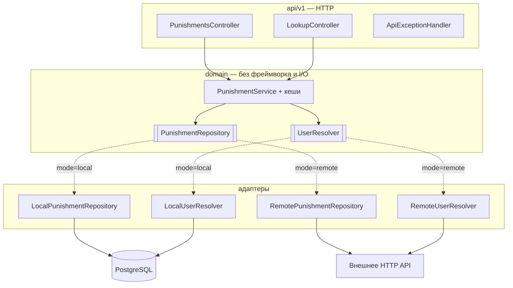

# ProxyPunishments — сервис

[](https://github.com/vanfek/proxypunishments-service/actions/workflows/ci.yml)
[](https://openjdk.org/projects/jdk/25/)
[](https://spring.io/projects/spring-boot)

*[English version](README.md)*

Реактивное хранилище наказаний для Minecraft-прокси — баны, муты и предупреждения. Обслуживает
[плагин ProxyPunishments для Velocity](https://github.com/vanfek/proxypunishments-plugin) по небольшому HTTP API.

Работает в одном из двух режимов, переключается одной переменной окружения:

| Режим    | Источник истины               | Когда нужен                                  |
|----------|-------------------------------|----------------------------------------------|
| `local`  | собственная схема в PostgreSQL | автономный деплой без внешнего бэкенда       |
| `remote` | существующее HTTP API          | наказания уже лежат в базе сайта             |

Плагин разницы не видит. Это и есть смысл архитектуры, а не побочный эффект.

---

## Попробовать

```bash
docker compose up --build
```

Дальше <http://localhost:8080/swagger-ui.html> и заголовок `X-Service-Token: dev-local-token`.
[`docs/api.http`](docs/api.http) — готовый набор запросов на весь сценарий: зарегистрировать игрока,
забанить, замутить, выдать предупреждение, посмотреть, снять, включая запросы, которые должны быть
отклонены.

## Архитектура

Порты и адаптеры: домен в центре, ниже слоя API нет ни одного фреймворкового типа.



Адаптеры выбираются через `@ConditionalOnProperty`, так что в рантайме существует только один
набор бинов, а смена режима — это рестарт, а не пересборка.

## Стек

Java 25 · Spring Boot 4.0 (WebFlux, Data R2DBC, Actuator, Validation) · PostgreSQL 18 ·
Liquibase · Caffeine · springdoc-openapi · Gradle 9 (Kotlin DSL) · Testcontainers

Реактивно насквозь: R2DBC и WebFlux, блокирующего драйвера на пути запроса нет. JDBC-драйвер лежит
рядом только потому, что он нужен Liquibase на старте.

## API

Все эндпоинты, кроме `/actuator/health`, требуют `X-Service-Token`.

```
GET    /api/v1/punishments?kind=&limit=&offset=            активные наказания, свежие сверху
GET    /api/v1/punishments/{uuid}/active?kind=             действующее наказание или 404
GET    /api/v1/punishments/{uuid}/history?limit=&offset=   журнал наказаний
POST   /api/v1/punishments                                 выдать бан или мут
DELETE /api/v1/punishments/{uuid}?kind=                    снять активное наказание
POST   /api/v1/warnings                                    записать предупреждение
GET    /api/v1/lookup?name=<ник>                           резолв ника в UUID
POST   /api/v1/known-players                               записать пару UUID/ник (режим local)
GET    /actuator/health                                    без авторизации
GET    /swagger-ui.html                                    интерактивная документация
```

`kind` — это `BAN` или `MUTE`, по умолчанию `BAN` везде, где он принимается. У игрока одновременно
могут быть активные бан и мут, и друг друга они не перекрывают. Предупреждение живёт только в
журнале: у него нет срока, нет активного состояния и его нечего снимать.

`limit` ограничен сотней, `offset` не может быть отрицательным — проверяется в сервисе, а не
принимается на веру от вызывающего.

## Конфигурация

| Переменная                      | Назначение                                              |
|---------------------------------|---------------------------------------------------------|
| `PROXYPUNISHMENTS_MODE`                | `local` или `remote`                                    |
| `PROXYPUNISHMENTS_SERVICE_TOKEN`       | общий секрет для `X-Service-Token`; **без дефолта**     |
| `SPRING_PROFILES_ACTIVE`        | `local` или `remote`                                    |
| `SPRING_R2DBC_URL`              | `r2dbc:postgresql://host:5432/proxypunishments`                |
| `SPRING_R2DBC_USERNAME/PASSWORD`| доступ к БД                                             |
| `SPRING_LIQUIBASE_URL/USER/PASSWORD` | то же по JDBC, только для миграций                 |
| `PROXYPUNISHMENTS_REMOTE_BASE_URL`     | базовый URL внешнего бэкенда (режим `remote`)           |
| `PROXYPUNISHMENTS_REMOTE_API_TOKEN`    | токен внешнего бэкенда                                  |
| `PROXYPUNISHMENTS_REMOTE_TOKEN_HEADER` | заголовок для него, по умолчанию `X-Server-Key`         |
| `PROXYPUNISHMENTS_REMOTE_PATH_*`       | раскладка эндпоинтов внешнего бэкенда                   |
| `PROXYPUNISHMENTS_REMOTE_PATH_*_MUTE`  | эндпоинты мутов; пусто — их у бэкенда нет               |

У токена нет значения по умолчанию намеренно: пустой или незаданный токен останавливает запуск,
а не превращается в тихий приём неаутентифицированных запросов. У путей для мутов, наоборот, дефолт
пустой: бэкенд, который умеет только баны, просто их не задаёт, и чтение и запись мутов вырождаются
в пустой результат, а не в ошибку.

## Про безопасность

- Токен сравнивается за константное время — его нельзя подобрать побайтово.
- Публичны только `/actuator/health` и его пробы. `env`, `metrics` и `prometheus` описывают
  внутренности деплоя и остаются за токеном.
- В ответах об ошибке — статус и короткое сообщение; детали исключения уходят в лог, а не в тело,
  которое плагин может вывести в чат.

## Модель данных

Три таблицы в схеме `proxypunishments`, создаются Liquibase:

- `punishments` — строка на бан или мут, различаются по `kind`. **Частичный уникальный индекс** по
  `(player_uuid, kind) WHERE active = true` делает «не больше одного активного наказания на игрока
  каждого вида» гарантией БД, а не соглашением в коде; параллельное двойное наказание всплывает как
  конфликт и повторяется, а не проходит незаметно. Раз `kind` входит в ключ, мут никогда не
  сталкивается с баном того же игрока.
- `ban_history` — журнал наказаний только на добавление: `BAN`, `PERMBAN`, `UNBAN`, `MUTE`,
  `PERMMUTE`, `UNMUTE` и `WARN`. Предупреждения живут здесь и больше нигде.
- `known_players` — UUID ↔ ник, чтобы список наказаний показывал ники, а не голые UUID.

Фоновая задача деактивирует истёкшие временные наказания обоих видов. Чтение их и так
отфильтровывает; задача нужна, чтобы частичный индекс не копил строки, которые уже ничего не значат.

## Тесты

```bash
./gradlew test
```

- домен — кеш с ключом «игрок + вид наказания», инвалидация при выдаче и снятии, бан и мут рядом,
  предупреждения, которые не становятся активными, регистронезависимый резолв ников, на рукописных
  in-memory портах
- HTTP — весь путь запроса через `WebTestClient`: коды, валидация, форма JSON
- безопасность — фильтр токена: отсутствующий, пустой, неверный и верный; какие пути actuator публичны
- интеграция — локальный адаптер против настоящего PostgreSQL через Testcontainers: то, чего фейк
  дать не может — `@Modifying`, частичный уникальный индекс по `(player_uuid, kind)`, join с ником

Интеграционные тесты сами пропускаются там, где нет Docker, и всегда идут в CI.

## Сборка

```bash
./gradlew bootJar        # build/libs/proxypunishments-service-1.0.0.jar
```

Нужен JDK 25. Gradle wrapper закоммичен.
