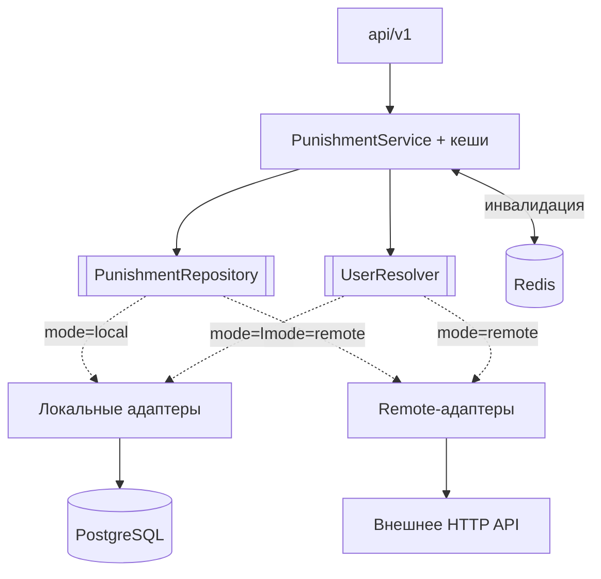

# ProxyPunishments — сервис

[](https://github.com/vanFEK/proxypunishments-service-example/actions/workflows/ci.yml)
[](https://openjdk.org/projects/jdk/25/)
[](https://spring.io/projects/spring-boot)

*[English version](README.md)*

Реактивное хранилище наказаний для Minecraft-сетей — баны, муты, IP-баны и предупреждения за одним
HTTP API. Обслуживает
[плагин ProxyPunishments](https://github.com/vanFEK/proxypunishments-plugin-example).

Два взаимозаменяемых источника истины, переключаются одной переменной окружения:

| Режим    | Источник истины                | Когда нужен                                  |
|----------|--------------------------------|----------------------------------------------|
| `local`  | собственная схема в PostgreSQL | автономный деплой                            |
| `remote` | существующее HTTP API          | наказания уже лежат в базе сайта             |

Плагин разницы не видит — это и есть смысл архитектуры, а не побочный эффект.

## Попробовать

```bash
docker compose up --build
```

Дальше <http://localhost:8080/swagger-ui.html> с заголовком `X-Service-Token: dev-local-token`.
[`docs/api.http`](docs/api.http) — готовый набор запросов на весь сценарий, включая те, которые
должны быть отклонены.

## Архитектура

Порты и адаптеры, ниже слоя API нет ни одного фреймворкового типа:



Адаптеры выбираются через `@ConditionalOnProperty`, поэтому в рантайме живёт только один набор
бинов, а смена режима — это рестарт, а не пересборка.

**Стек.** Java 25 · Spring Boot 4.0 (WebFlux, Data R2DBC, Actuator) · PostgreSQL 18 · Liquibase ·
Caffeine · Redis (опционально) · springdoc-openapi · Gradle 9 · Testcontainers. Реактивно насквозь;
JDBC-драйвер лежит рядом только потому, что он нужен Liquibase на старте.

## API

Все эндпоинты, кроме `/actuator/health`, требуют `X-Service-Token`.

```
GET    /api/v1/punishments?kind=&limit=&offset=            активные наказания, свежие сверху
GET    /api/v1/punishments/{uuid}/active?kind=             действующее наказание или 404
GET    /api/v1/punishments/{uuid}/history?limit=&offset=   журнал наказаний
POST   /api/v1/punishments                                 выдать бан, мут или IP-бан
DELETE /api/v1/punishments/{uuid}?kind=                    снять активное наказание
GET    /api/v1/punishments/ip/{address}/active             действующий IP-бан или 404
DELETE /api/v1/punishments/ip/{address}                    снять IP-бан с адреса
GET    /api/v1/players/{uuid}/alts?limit=                  другие аккаунты с того же адреса
POST   /api/v1/warnings                                    записать предупреждение
GET    /api/v1/lookup?name=<ник>                           резолв ника в UUID
POST   /api/v1/known-players                               записать UUID/ник/адрес (режим local)
GET    /actuator/health                                    без авторизации
GET    /swagger-ui.html                                    интерактивная документация
```

`kind` — `BAN`, `MUTE` или `IP_BAN`, по умолчанию `BAN`. `limit` ограничен сотней, `offset` не может
быть отрицательным — проверяется в сервисе, а не принимается на веру.

## Конфигурация

| Переменная                              | Назначение                                             |
|-----------------------------------------|--------------------------------------------------------|
| `PROXYPUNISHMENTS_MODE`                 | `local` или `remote`                                   |
| `PROXYPUNISHMENTS_SERVICE_TOKEN`        | общий секрет для `X-Service-Token`; **без дефолта**    |
| `SPRING_R2DBC_URL/USERNAME/PASSWORD`    | подключение к БД                                       |
| `SPRING_LIQUIBASE_URL/USER/PASSWORD`    | то же по JDBC, только для миграций                     |
| `PROXYPUNISHMENTS_REMOTE_BASE_URL`      | базовый URL внешнего бэкенда (режим `remote`)          |
| `PROXYPUNISHMENTS_REMOTE_API_TOKEN`     | токен внешнего бэкенда                                 |
| `PROXYPUNISHMENTS_REMOTE_PATH_*`        | раскладка эндпоинтов; пустые пути мутов или IP означают, что их у бэкенда нет |
| `PROXYPUNISHMENTS_REDIS_ENABLED`        | инвалидация кеша между нодами; по умолчанию `false`    |
| `PROXYPUNISHMENTS_REDIS_HOST/PORT`      | где слушает Redis                                      |
| `PROXYPUNISHMENTS_DISCORD_ENABLED`      | оповещения в вебхук; по умолчанию `false`              |
| `PROXYPUNISHMENTS_DISCORD_WEBHOOK_URL`  | URL вебхука Discord                                    |

У токена нет значения по умолчанию намеренно: пустой или незаданный токен останавливает запуск, а не
превращается в тихий приём неаутентифицированных запросов.

С включённым Redis выдача и снятие публикуют событие инвалидации, которое сразу подхватывает каждая
реплика сервиса и каждый прокси, вместо того чтобы всем пережидать свой TTL. Redis выключен или
недоступен — всё откатывается на TTL, ничего не падает.

## Безопасность

- Токен сравнивается за константное время.
- Публичны только `/actuator/health` и его пробы; `env`, `metrics` и `prometheus` остаются за
  токеном, потому что описывают внутренности деплоя.
- В ответах об ошибке — статус и короткое сообщение; детали уходят в лог, а не в тело, которое
  плагин может вывести в чат.

## Модель данных

Три таблицы в схеме `proxypunishments`, создаются Liquibase:

- `punishments` — строка на наказание. **Частичный уникальный индекс** делает «не больше одного
  активного наказания на игрока на тип» гарантией БД, а не соглашением в коде; второй такой же
  покрывает активные IP-баны по адресу. Параллельный двойной бан всплывает как конфликт и
  повторяется, а не проходит незаметно.
- `ban_history` — журнал только на добавление, включая снятия и предупреждения.
- `known_players` — UUID, ник и последний адрес; благодаря ему поиск альтов — это обращение к
  индексу, а не скан.

Фоновая задача убирает истёкшие наказания, чтобы частичный индекс не копил строки, которые уже
ничего не значат.

## Персональные данные

Сервис хранит адреса игроков, потому что без них IP-баны и поиск альтов невозможны. Сам он их не
удаляет: срок хранения — на усмотрение оператора, и деплою под GDPR нужна политика поверх сервиса.

## Метрики

`/actuator/prometheus`, за токеном: `proxypunishments.punishments.issued|lifted{kind}`,
`proxypunishments.cache.lookups{cache,result}`, `proxypunishments.repository.calls{operation}`,
`proxypunishments.invalidations.published|received`, `proxypunishments.webhook.deliveries{outcome}`.

## Нагрузочный профиль

В [`docs/load/`](docs/load/) лежит профиль k6 с той пропорцией, которую даёт живая сеть: почти
только проверки входа и тонкая струйка действий модераторов. Таблица результатов там намеренно
пустая — цифры чего-то стоят только с реального прогона на известном железе.

## Сборка

```bash
./gradlew bootJar        # build/libs/proxypunishments-service-1.0.0.jar
```

Нужен JDK 25. `build` также прогоняет Checkstyle (`config/checkstyle/checkstyle.xml`); тег `v*`
запускает релиз. См. [CHANGELOG.md](CHANGELOG.md).

## Тесты

110 тестов:

- домен — кеширование по типу, инвалидация при записи, регистронезависимый резолв ников, на
  рукописных in-memory портах
- HTTP — весь путь запроса через `WebTestClient`: коды, валидация, форма JSON
- безопасность — фильтр токена и какие пути actuator публичны
- интеграция — локальный адаптер против настоящего PostgreSQL через Testcontainers: `@Modifying`,
  оба частичных уникальных индекса, join с ником и запрос альтов

Интеграционные тесты пропускаются там, где нет Docker, и всегда идут в CI.
